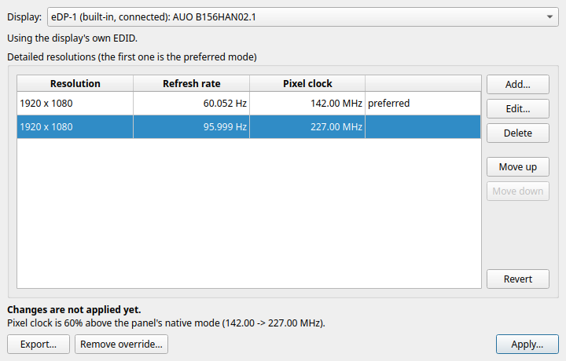
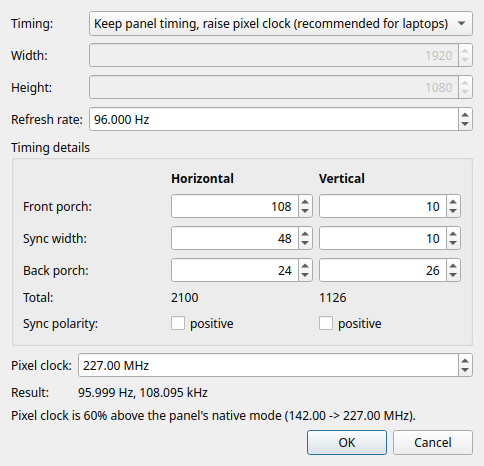

# linuxcru

Custom refresh rates for laptop and desktop displays on Linux, with the
"type a refresh rate and you're done" workflow of
[CRU](https://www.monitortests.com/forum/Thread-Custom-Resolution-Utility-CRU)
on Windows.



Many laptop panels sold as 60 Hz run fine at a higher refresh rate. On
Windows, CRU calculates the timings and adds the mode for you. On Linux,
`xrandr --newmode` doesn't work on Wayland, and the reliable route, a
boot-time **EDID override**, means filling in a dozen timing values by hand,
building a binary EDID file and editing GRUB and initramfs settings.

linuxcru does all of that for you:

1. It reads the display's EDID and lists its detailed resolutions, like CRU.
2. You add a mode by typing a refresh rate. Porches, sync widths and pixel
   clock are filled in automatically.
3. It writes a valid EDID (checksums included), installs it as a kernel
   firmware override and updates GRUB and the initramfs.
4. You reboot and pick the new refresh rate in System Settings.



> [!WARNING]
> Running a display outside its specification can cause flicker, a black
> screen or, in rare cases, damage. Increase the refresh rate step by step
> and use it at your own risk. Read the [recovery guide](docs/recovery.md)
> **before** you apply your first override.

## Features

- **CRU-style mode list:** add, edit, delete and reorder detailed
  resolutions. The first one is the preferred mode.
- **Automatic timings:**
  - *Keep panel timing*: the panel's own porches with a higher pixel clock.
    This is what usually works for laptop panels, and it's what CRU does when
    you type a new refresh rate.
  - *CVT reduced blanking v2*, *CVT reduced blanking* and *CVT standard*,
    matching the `cvt` tool.
  - *Manual*: edit any value, and the pixel clock follows to keep the refresh
    rate you asked for.
- **Works on Wayland and X11:** the override is applied by the kernel, so
  every desktop sees the new mode.
- **Works with Secure Boot:** firmware overrides are allowed under kernel
  lockdown, unlike debugfs-based tricks.
- **Safe by design:**
  - only a tiny helper runs as root, through the normal password prompt
  - every change can be previewed with `--dry-run`
  - replaced files are backed up
  - GRUB's recovery mode always boots without the override
- **Keeps the rest of the EDID:** panel name, serial, CTA data blocks and
  colour data are left as they are. Range limits are widened when needed.
- **Command line tool:** everything the window does is also available in the
  terminal.

## Requirements

- Linux with a **Debian/Ubuntu-style boot setup (GRUB + initramfs-tools)** to
  install overrides: Kubuntu, Ubuntu, KDE neon, Debian, Linux Mint, Pop!_OS
  with GRUB, and so on. On other distributions you can still generate the
  EDID file and install it by hand.
- Python 3.11 or newer.
- PySide6 for the window (installed with the `gui` extra).

Developed and tested on Kubuntu with KDE Plasma 6 (Wayland), on an AUO
B156HAN02.1 laptop panel overclocked from 60 to 96 Hz.

## Installation

With [pipx](https://pipx.pypa.io/) (recommended):

```bash
sudo apt install pipx
pipx install git+https://github.com/colin-110/linuxcru
pipx inject linuxcru PySide6-Essentials   # for the window
```

From a clone:

```bash
git clone https://github.com/colin-110/linuxcru
cd linuxcru
python3 -m venv .venv
.venv/bin/pip install ".[gui]"
.venv/bin/linuxcru-gui
```

To get a menu entry, copy `data/linuxcru.desktop` to
`~/.local/share/applications/`.

## Usage

### Window

Run `linuxcru-gui`:

1. Pick the display.
2. Click **Add…** and type the refresh rate (for example `96`). Keep the
   *Keep panel timing* method for a laptop panel.
3. Click **Apply…** and enter your password. Updating the boot files takes
   about a minute.
4. Reboot, then choose the new rate in *System Settings > Display & Monitor*.

To make a mode the default, move it to the top of the list.

### Command line

```text
$ linuxcru calc 96
1920x1080 @ 95.999 Hz  227.00 MHz  108.095 kHz
     horizontal: 1920 active, 108 front, 48 sync, 24 back = 2100 total
     vertical:   1080 active, 10 front, 10 sync, 26 back = 1126 total   (-hsync -vsync)
  ! Pixel clock is 60% above the panel's native mode (142.00 -> 227.00 MHz).

$ linuxcru apply 96 --dry-run      # show what would change
$ linuxcru apply 96                # install (asks for your password)
$ linuxcru status                  # what is installed and what is active
$ linuxcru reset                   # remove the override
```

| Command | What it does |
|---|---|
| `linuxcru list` | Lists the displays. |
| `linuxcru show [-c eDP-1]` | Shows the detailed resolutions in the EDID. |
| `linuxcru calc HZ` | Calculates a timing without changing anything. |
| `linuxcru generate HZ -o file.bin` | Writes an EDID file with the new mode added. |
| `linuxcru apply HZ` | Adds the mode and installs the override. |
| `linuxcru status` | Shows installed and active overrides. |
| `linuxcru reset` | Removes linuxcru's override. |

Useful options:

| Option | Meaning |
|---|---|
| `-m panel\|cvt-rb2\|cvt-rb\|cvt` | Timing method. |
| `-r 1280x720` | Resolution, if you don't want the native one. |
| `--preferred` | Make the new mode the default. |
| `--fresh` | Drop previously added modes. |
| `--edid FILE` | Start from an EDID file instead of the connected display. |
| `--replace-existing` | Take over an override you set up by hand in `/etc/default/grub`. A backup is kept. |

## How it works

Linux can replace a display's EDID with a file from `/lib/firmware`, using the
`drm.edid_firmware` kernel parameter. linuxcru installs:

| File | Purpose |
|---|---|
| `/lib/firmware/edid/linuxcru-<connector>.bin` | The modified EDID. |
| `/etc/initramfs-tools/hooks/linuxcru` | Puts it in the initramfs so the graphics driver finds it early. |
| `/etc/default/grub.d/99-linuxcru.cfg` | Adds `drm.edid_firmware=<connector>:edid/linuxcru-<connector>.bin` to normal boot entries. |

It then runs `update-initramfs` and `update-grub`. Files it replaces are copied
to `/var/lib/linuxcru/backups/` first. `linuxcru reset` removes all three files
and updates the boot files again.

See [docs/design.md](docs/design.md) for the architecture and the reasoning
behind it.

## Recovery

If the screen stays black after a reboot:

1. Open the GRUB menu: hold **Shift** (BIOS) or press **Esc** (UEFI) while
   booting.
2. Choose **Advanced options > recovery mode**. Recovery mode never uses the
   override.
3. Run `linuxcru reset`, or follow the manual steps in
   [docs/recovery.md](docs/recovery.md).

## Development

```bash
python3 -m venv .venv
source .venv/bin/activate
pip install -e ".[dev,gui]"

pytest          # tests (GUI tests run offscreen; edid-decode tests need edid-decode)
ruff check .    # lint
ruff format .   # format
mypy            # type check
```

The installer is tested against a fake filesystem, so the tests never touch
your real boot setup. Generated EDIDs are checked with `edid-decode`, and the
CVT calculations are compared against the `cvt` tool.

## Credits

Inspired by CRU (Custom Resolution Utility) by ToastyX. linuxcru is an
independent project, not affiliated with CRU, and shares no code with it.

## License

GPL-3.0-or-later. See [LICENSE](LICENSE).
